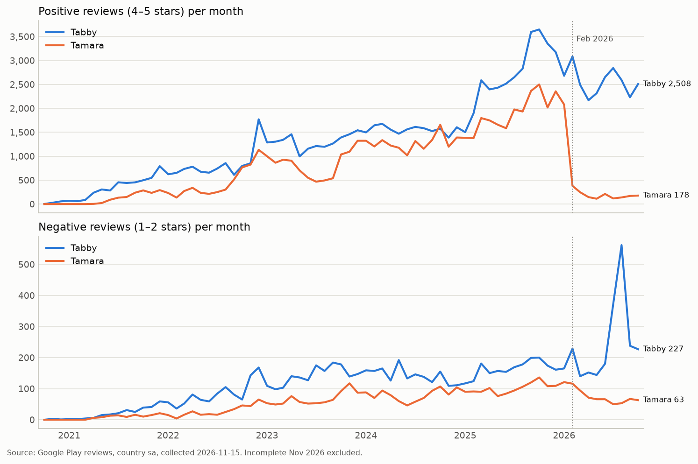

# BNPL in Saudi Arabia: What Users Are Saying

An analysis of public app-store reviews of **Tabby** and **Tamara**, Saudi Arabia's two biggest Buy Now, Pay Later apps. It covers data collection, Arabic NLP, sentiment and topic modeling, trends over time against real events, a served model, and a Flutter web dashboard.

> 🚧 Work in progress, built phase by phase. Live demo, key findings and model results will appear here.

## Status

| Phase | Description | Status |
|---|---|---|
| 1 | Data collection | ✅ code done, data collected locally |
| 2 | Cleaning and EDA | ✅ |
| 3 | Sentiment modeling | ⏳ |
| 4 | Topic modeling | ⏳ |
| 5 | Trends and events | ⏳ |
| 6 | API | ⏳ |
| 7 | Flutter dashboard | ⏳ |
| 8 | README and polish | ⏳ |

## Phase 1: Data collection

**Sources**

| Source | App IDs | Coverage | Notes |
|---|---|---|---|
| Google Play (`google-play-scraper`) | `app.tabby.client`, `co.tamara.user` | Full available history, country `sa`, languages `ar` + `en` | Main dataset |
| Apple App Store public RSS | `1528022364`, `1533512531` | Most recent reviews only (max 500 per app) | Optional, labelled `source = app_store_rss`; not comparable in volume. The feed is occasionally empty, so re-run if a pull returns nothing |
| Google Trends (manual CSV export) | "تابي", "تمارا" | Saudi Arabia, monthly from Dec 2018 (`trends_time.csv`) and by region (`trends_region.csv`) | Downloaded by hand from trends.google.com into `data/external/` (All categories, Web Search, both terms in one query). Values are relative interest (0–100), not search counts. English names were far less searched and are not used |
| SAMA payments statistics via [KAPSARC](https://data.kapsarc.org) | dataset `pos-transactions` | Monthly, Jan 2019 onward in the wide file | POS and mada e-commerce sales and transactions, as macro context for BNPL growth |
| Events timeline | n/a | n/a | Hand-made `data/external/events.csv` with a source URL for every row |

Package IDs were checked against the live store listings (Tabby's `app.tabby.cashier` is the separate *Tabby Business* app, so it is not used).

**Fields kept:** review id, app, source, country, query language, text, star rating, review date, thumbs-up count, app version, whether the developer replied, and the reply date.
**Never stored:** reviewer names, profile images, user IDs, or developer reply text.

**SAMA payments data:** `python -m src.collect.sama_kapsarc` saves the full dataset (`sama_pos_ecommerce.csv`, long format) and a monthly wide file (`sama_pos_ecommerce_monthly_wide.csv`) starting January 2019. In the wide file, sales are in millions of SAR, columns have short names (e.g. `ecom_mada_sales_m_sar`, `ecom_mada_txn_count`, `pos_sales_m_sar`), and there are two derived columns: `ecom_avg_ticket_sar` (e-commerce sales / transactions) and `ecom_share_of_card_spending` (e-commerce / (e-commerce + POS) sales).
> **Note:** the e-commerce series covers **mada debit cards only**. It excludes Visa, Mastercard and credit-card online spending, so it understates total online spending.

**Google Trends:** `python -m src.collect.google_trends` cleans the two manual exports into `data/processed/trends_time.parquet` (`month, tabby, tamara, is_partial`) and `trends_region.parquet`. It skips any lines Google puts before the header row, maps `"<1"` to 0.5, rolls daily or weekly exports up to monthly, and flags the incomplete download month. It also saves the chart below. Download date and Trends settings are recorded under `trends` in `config.yaml`.


> "تمارا" (Tamara) is also a first name, so part of its interest is unrelated to the app. This likely explains the small non-zero values in 2019–2020.

**Incremental collection:** each run reads what is already in `data/raw/` and only pages through reviews newer than the last stored date (with a one-day overlap). New reviews go to `data/raw/play_reviews_<app>_<YYYYMMDD>.parquet`. Requests are rate-limited (`collection.play_store.sleep_seconds` in `config.yaml`) and retried with backoff.

## Phase 2: Cleaning and EDA

**Cleaning** (`python -m src.clean.pipeline` → `data/processed/reviews_clean.parquet`, log in [`reports/cleaning_log.csv`](reports/cleaning_log.csv)):
- **Arabic normalization** into a separate `text_norm` column (the original text is kept): Unicode NFKC, alef forms → ا, ة → ه, ى → ي, diacritics and tatweel removed, Arabic-Indic digits → 0-9, repeated letters capped at two (حلووووو → حلوو).
- **Emoji** are extracted into their own column as a feature.
- **Language** is detected from the text (Arabic / English / mixed / Arabizi / emoji only), not from the store's language bucket.
- **Removed:** 2 double submissions and 176 reviews with no usable content (punctuation, numbers, single letters, other scripts). Repeated *text* is not treated as a duplicate: thousands of different people write "جيد" or "👍".
- **Emoji-only reviews (2.6%)** are kept for analysis but flagged `trainable = False` for text models.

**EDA** ([`notebooks/02_eda.ipynb`](notebooks/02_eda.ipynb)), Google Play, 183,341 reviews:
- **85% of reviews are 5 stars** and the median positive review is 2 words, while the median 1-star review is 12–13 words. Classes are very imbalanced, so models will be judged on macro-F1.
- **Tamara's review mix changed in February 2026:** positive reviews fell about 90% (about 2,200 → 190 a month), negative reviews only about 35% (113 → 72). Its average rating falls from 4.7 to 3.9 mostly because of who is reviewing, not because complaints rose.
- **Tabby's negative reviews spiked in July–August 2026** (371 and 562 a month vs. about 150–230 normally), a candidate for the events analysis.
- **Both apps reply to about 90% of 1–2 star reviews.** The overall gap (Tabby 56% vs. Tamara 11%) comes from Tabby also replying to positive reviews, which it started doing in 2024. Tamara replies faster (median under 1 hour vs. about 22 hours).
- **Top complaints:** customer service for both apps; app updates causing a blank white screen for Tabby; late fees and the first payment for Tamara.
- **Language:** Tabby's reviews are 52% English and 46% Arabic; Tamara's are 60% Arabic. Arabizi (Arabic in Latin letters) is essentially absent.




## How to run

```bash
python -m venv .venv
# Windows: .venv\Scripts\activate    macOS/Linux: source .venv/bin/activate
pip install -r requirements.txt

python -m src.collect.play_store                 # Google Play, both apps (incremental)
python -m src.collect.play_store --max-reviews 50  # quick test
python -m src.collect.play_store --full          # rescan full history, skipping stored IDs
python -m src.collect.app_store                  # optional Apple RSS reviews
python -m src.collect.sama_kapsarc               # SAMA POS / mada e-commerce statistics
python -m src.collect.google_trends              # clean manual Google Trends exports + chart
python -m src.clean.pipeline                     # Phase 2: clean, normalize, tag language
jupyter notebook notebooks/02_eda.ipynb          # Phase 2: EDA (saves reports/figures/eda_*.png)

pytest
```

All settings (app IDs, country, languages, rate limits, paths) live in `config.yaml`.

## Data and ethics

Raw scraped data is not committed or redistributed (`data/raw/` is gitignored). Only public review text and ratings are used, and no names or personal data are stored. The repository will contain only an anonymized hand-labelled gold set, small anonymized samples, aggregates and figures.
