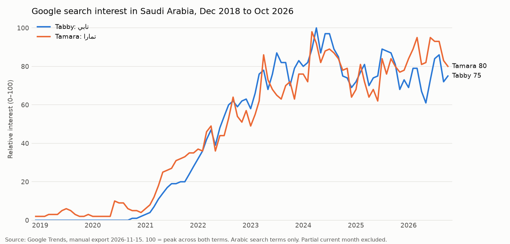
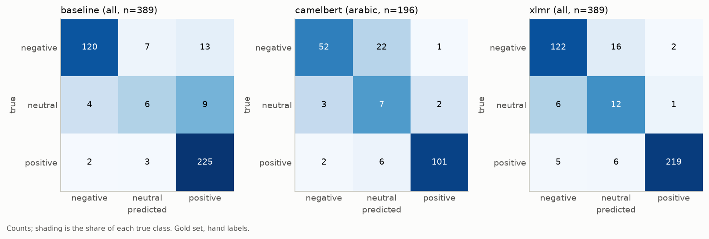
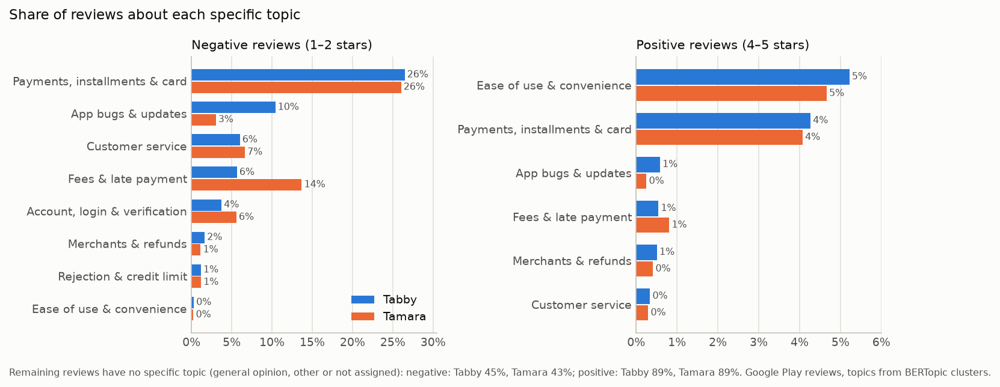
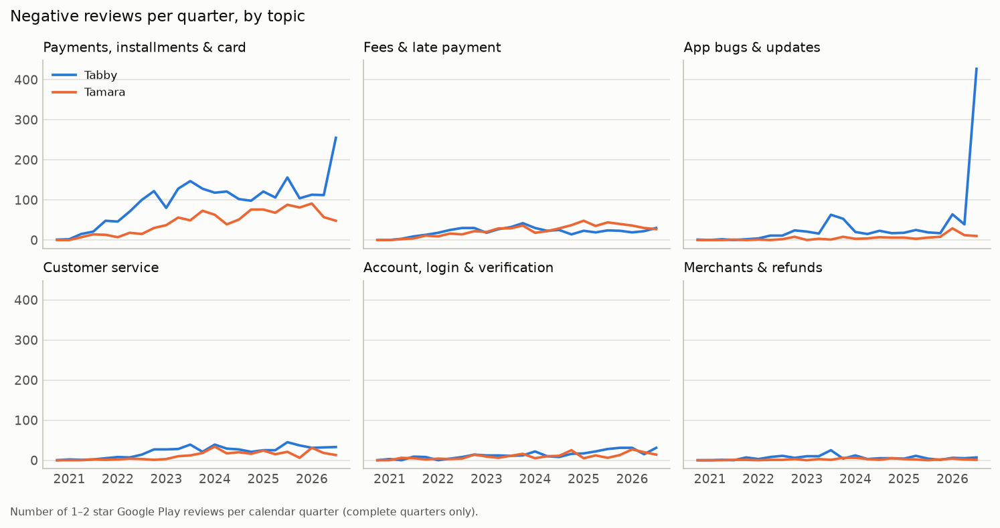

# BNPL in the Gulf: What Tabby and Tamara Users Are Saying

An analysis of about 184,000 public app-store reviews of **Tabby** and **Tamara**, two Buy Now, Pay Later (BNPL) apps, using Arabic and English NLP. Google Play does not filter reviews by country, so the reviews come from users across the Gulf: Arabic reviews appear to come mostly from Saudi Arabia and English reviews mostly from the UAE.

> **Status:** data collection, cleaning and exploratory analysis are complete. Sentiment models are built and evaluated on a hand-labeled test set, with an error analysis, and topics are modeled for negative and positive reviews. The events analysis, an API and a web dashboard are planned (see [Roadmap](#roadmap)).

## Key findings

From 183,341 Google Play reviews (Arabic and English, October 2020 to November 2026):

- **Who is reviewing.** Of the 0.8% of reviews that name a country, city or currency, Arabic ones point to Saudi Arabia 84% of the time and English ones to the UAE 65% of the time. Tabby's reviews are about half English, Tamara's 60% Arabic.
- **Ratings are very positive.** 84% of reviews are 5 stars. Positive reviews are short (median 2 words), while 1-star reviews have a median of 12–13 words, so most of the detail about problems is in the negative reviews.
- **Tamara's review mix changed in February 2026.** Positive reviews fell by about 90% (from about 2,200 to 190 a month), negative reviews by about 37% (from 114 to 72). The average rating dropped from 4.7 to 3.9 mainly because fewer satisfied users reviewed, not because complaints rose. The change lines up with app version 6.0, which suggests the app stopped asking satisfied users for a rating (not confirmed). The negative reviews that disappeared were mostly general-opinion ones (45 → 12 a month); 1–2 star reviews about a specific problem changed little (55 → 50 a month).
- **Tabby's negative reviews spiked in July–August 2026**, reaching 370 and 561 a month against 137–239 in the other months from October 2025 to October 2026. 85% of the Tabby reviews that mention a blank white screen fall in these two months, and topic modeling puts most of the increase in app bugs and updates: such reviews rose from about 18 a month to 123 in July and 257 in August.
- **Both companies reply to about 90% of 1–2 star reviews.** The difference in overall reply rate (Tabby 56%, Tamara 11%) comes from Tabby also replying to positive reviews, which it has done since 2024. In 2025–26, Tamara answered 1–2 star reviews in a median of under an hour and Tabby in about 20 hours; in 2022–23 it was the reverse (Tabby 2–5 hours, Tamara 36–39 hours).
- **Customer service is the most common complaint phrase**, appearing in about 8% of negative reviews for both apps. Phrases typical of negative reviews also point to a blank white screen after app updates (Tabby, 2% of negative reviews) and to late fees and the first payment (Tamara, 1–2% each).
- **Complaints are mostly about app bugs, customer service and payments.** In 155 hand-labeled 1–2 star reviews (weighted to the population mix of apps and languages), app bugs and updates make up 22% (30 reviews), customer service 15% (25) and payments 12% (19); about a third have no specific topic. Topic modeling shows clear differences between the apps: app bugs are 10% of Tabby's 1–2 star reviews against 3% of Tamara's, and fees and late payment 14% of Tamara's against 6% of Tabby's. It understates app and service complaints overall, though: on negative reviews, simple keyword rules agree better with the hand labels than BERTopic clusters do (Cohen's kappa 0.49 vs. 0.35, difference 95% CI 0.06 to 0.23). Positive reviews are mostly general praise.
- **A simple model matches the pretrained ones.** On 389 hand-labeled reviews, a TF-IDF baseline trained on star ratings reaches a macro-F1 of 0.73, against 0.77 for a multilingual XLM-RoBERTa model; on Arabic reviews, 0.70 against 0.68 for CAMeLBERT-DA and 0.74 for XLM-RoBERTa. None of the differences is statistically clear. All models separate negative from positive reviews well (0.93–0.98); neutral reviews are the hard part.


More charts and tables are in [`notebooks/02_eda.ipynb`](notebooks/02_eda.ipynb).

## Data

| Source | Coverage | Use |
|---|---|---|
| Google Play reviews (`google-play-scraper`): `app.tabby.client`, `co.tamara.user` | Full available history for Arabic and English queries, all countries; 183,341 reviews after cleaning | Main dataset |
| Apple App Store public RSS: `1528022364`, `1533512531` | Most recent 500 reviews per app, Saudi storefront | Saudi-only comparison sample |
| Google Trends, manual export | Monthly search interest for "تابي" and "تمارا" in Saudi Arabia from December 2018, plus each term's share of interest by region | Saudi-market context for the events analysis |
| SAMA payments statistics via [KAPSARC](https://data.kapsarc.org) (`pos-transactions`) | Monthly POS and mada e-commerce sales and transactions in Saudi Arabia from January 2019 | Saudi-market context for the events analysis |
| Events timeline (`data/external/events.csv`) | Planned: regulation, funding, product and seasonal events, each with a source URL (not filled yet) | Events analysis |

**Fields kept:** review ID, app, source, query language, text, star rating, review date, thumbs-up count, app version, whether the developer replied, and the reply date. Times are stored in UTC. Reviewer names, profile images and user IDs are never stored.

**Notes on the data:**
- Google Play returns the same reviews whatever store country is requested, so the reviews come from every country where the apps are used. Only 0.8% of reviews name a country, city, currency or national service. Among those, Arabic reviews point to Saudi Arabia (84%) more than to the UAE (13%), and English reviews to the UAE (65%) more than to Saudi Arabia (34%). The App Store sample comes from the Saudi storefront and is more Arabic than Google Play over the same dates (Tabby 67% vs. 41%, Tamara 78% vs. 60%). The events analysis will therefore use Arabic reviews as the closest stand-in for Saudi users.
- Package IDs were checked against the live store listings. Tabby's `app.tabby.cashier` is a separate merchant app and is not used.
- The Google Trends values are a relative index (0–100) on a common scale for both terms, not search volumes. The region export gives each term's share of the two terms' combined interest within a region (each row sums to 100), not the level of interest. The English terms "Tabby" and "Tamara" were excluded because they had much lower search interest and are ambiguous. Export settings are recorded in `config.yaml`.
- The SAMA e-commerce series covers mada debit cards only and excludes Visa, Mastercard and credit-card spending.



## Method

**Collection.** Reviews are collected incrementally, newest first. Each run reads back to the newest review of the last complete run, with a seven-day overlap. Reviews read again are stored again and the latest copy is used, so edits and new developer replies are picked up. The resume point only moves forward after a run finishes without errors or a test cap, so a failed run is repeated rather than leaving a gap. Requests are rate-limited and retried, and raw files are stored as Parquet.

**Cleaning.** The pipeline ([`src/clean/pipeline.py`](src/clean/pipeline.py)) removed 2 double submissions, 73 reviews written only in other scripts (mostly Bengali and Malayalam) and 103 reviews with no usable content (punctuation, digits or a single letter). Identical text from different reviewers (for example "جيد" or "👍") is kept, since each is a separate opinion. Each step is recorded in [`reports/cleaning_log.csv`](reports/cleaning_log.csv).

**Arabic normalization.** A normalized copy of each review is stored next to the original text. It applies Unicode NFKC, unifies alef forms (أ إ آ → ا), taa marbuta (ة → ه) and alef maqsura (ى → ي), removes diacritics and tatweel, converts Arabic-Indic digits, and caps runs of a repeated letter or symbol at two (حلووووو → حلوو). Digits are not capped, so numbers keep their value. Emoji are extracted into a separate column for use as features.

**Language detection.** Language is detected from the text rather than from the store's query language, because each query bucket contains about 2,000 reviews in the other language. Reviews are tagged as Arabic (50%), English (47%), emoji only (2.6%) or mixed (0.1%). No Arabizi (Arabic written in Latin letters) was found. Emoji-only reviews are included in the analysis but excluded from text-model training.

**Gold test set.** 400 Google Play reviews are labeled by hand for sentiment and main topic, with the star rating hidden. The sample is stratified by app, language and star group (40% 1–2 star, 25% 3 star, 35% 4–5 star per app and language), so negative and neutral reviews are over-sampled; each row carries a weight that restores population proportions. Review IDs are replaced by a hash, e-mail addresses, URLs and long numbers are masked, and rows flagged as containing personal information have their text removed. Gold reviews are excluded from model training. A reported problem counts as negative even when it is written calmly; neutral is used for questions, suggestions without a complaint, factual statements and unclear or balanced reviews. 11 reviews flagged as unclear or not about the app are left out, leaving 389 (140 negative, 19 neutral, 230 positive). To check consistency, 50 random rows were labeled a second time by the same person without seeing the first labels: of the 48 usable rows, Cohen's kappa was 0.92 for sentiment and 0.84 for topic.

**Sentiment models.** A TF-IDF baseline (character 2–5-grams and word 1–2-grams, logistic regression) is trained on star labels (1–2 stars negative, 3 neutral, 4–5 positive). Its class weighting was chosen on a held-out dev split of star-labeled reviews: square-root balanced weights reached a dev macro-F1 of 0.60, against 0.57 without weights and 0.54 with fully balanced weights, which predicted neutral for 20% of dev reviews when only 2% are neutral. Two pretrained models are used without further training: CAMeLBERT-DA sentiment (Arabic only) and a multilingual XLM-RoBERTa sentiment model (Arabic and English), each pinned to a fixed revision. Results on the gold set are reported as macro-F1 with stratified bootstrap intervals, population-weighted metrics, a negative-vs-positive view, and paired bootstrap intervals for the difference between models.

**Topic modeling.** 1–2 star and 4–5 star Google Play reviews in Arabic and English are modeled separately with BERTopic. Reviews with the same normalized text are embedded once with a multilingual sentence-transformer (`paraphrase-multilingual-MiniLM-L12-v2`, pinned to a fixed revision) and then counted once per review. UMAP and HDBSCAN group the texts into clusters, and c-TF-IDF on the normalized text (words of letters only, without stop words) gives each cluster's keywords. Unclustered texts join the most similar cluster if the cosine similarity of their embeddings is at least 0.6; the rest stay unassigned. Each cluster is named with one of the gold-set topics by matching its top keywords against keyword lists in `config.yaml`: it gets the specific topic with the largest share of its keyword weight if that share is at least 15%, and otherwise general opinion or other. As a simpler comparison, each review also gets a topic from the keyword lists alone. Both are checked against the hand-labeled topics of the gold set.

**Distinctive phrases.** Words and two-word phrases are ranked with the weighted log-odds ratio with an informative Dirichlet prior (Monroe, Colaresi & Quinn, 2008), comparing 1–2 star with 4–5 star reviews, separately for each app and language. Counts are the number of reviews that contain a phrase, and the prior is weak, so the ranking is close to a smoothed log-odds ratio. It shows which phrases separate negative from positive reviews, not which are most frequent; how often complaint phrases occur is counted separately.

## Sentiment results

Sentiment on the 389 usable gold reviews (hand labels: negative, neutral, positive), with 95% stratified bootstrap intervals. The population-weighted column reweights the sample to the real mix of reviews, in which 5-star reviews dominate. The last column uses only reviews labeled negative or positive and compares each model's negative and positive probabilities.

| Model | Reviews | Macro-F1 (95% CI) | Population-weighted macro-F1 | Negative vs. positive macro-F1 |
|---|---|---|---|---|
| TF-IDF baseline | All (389) | 0.73 (0.66–0.80) | 0.66 | 0.95 |
| XLM-RoBERTa | All (389) | 0.77 (0.71–0.83) | 0.81 | 0.96 |
| TF-IDF baseline | Arabic (196) | 0.70 (0.60–0.78) | 0.64 | 0.93 |
| CAMeLBERT-DA | Arabic (196) | 0.68 (0.61–0.75) | 0.71 | 0.95 |
| XLM-RoBERTa | Arabic (196) | 0.74 (0.66–0.81) | 0.82 | 0.94 |
| TF-IDF baseline | English (193) | 0.77 (0.63–0.88) | 0.76 | 0.97 |
| XLM-RoBERTa | English (193) | 0.83 (0.68–0.93) | 0.68 | 0.98 |

- **No model is clearly better.** The paired bootstrap interval for every difference between two models includes zero, with and without population weights. For XLM-RoBERTa against the baseline on all reviews the difference is +0.04 (95% CI −0.05 to 0.12). The baseline was trained on star-labeled reviews of the same two apps, while the pretrained models were trained on other kinds of text, mainly tweets.
- **Neutral is the hard class.** Only 19 of the 389 reviews are neutral by hand, and the models' neutral F1 is 0.29–0.57, against 0.79–0.98 for negative and positive. Most of the differences between models, and the width of the intervals, come from this class. The weighted figures rest on very few neutral reviews and have wide intervals, so they point in different directions for Arabic and English.
- **The models make different mistakes.** The pretrained models most often read a calmly written complaint as neutral (22 of CAMeLBERT's 36 errors and 16 of XLM-RoBERTa's 36), for example "ليس لديهم تواصل عن طريق الواتساب" ("they have no WhatsApp contact"). The baseline almost never predicts neutral, because only 2% of its star-labeled training reviews have 3 stars, and reads polite requests such as "please include stc pay as one payment option" as positive.
- **Noisy star labels did not carry over.** On the 134 gold reviews whose hand label differs from the star group, the baseline follows the text (116 reviews) rather than the stars (12). It labels 34 of the 35 positive-text 1–2 star reviews as positive.
- **Typical hard cases** are Arabic reviews (baseline 25 errors on 196 Arabic reviews vs. 13 on 193 English; XLM-RoBERTa 27 vs. 9), mixed praise-and-complaint reviews, and dialect or misspelled words ("ماجازلي", "help full"). No sarcastic review appears among the errors. Examples are in [`notebooks/03_sentiment_models.ipynb`](notebooks/03_sentiment_models.ipynb).



Full results are in [`reports/sentiment_results_gold.csv`](reports/sentiment_results_gold.csv), with the paired differences in [`reports/sentiment_paired_gold.csv`](reports/sentiment_paired_gold.csv).

## Topic results

Topic shares in 1–2 star reviews by three methods. The BERTopic and keyword-rule shares cover all 13,226 negative reviews in Arabic and English. The hand-label shares come from the 155 negative gold reviews, weighted to the population mix of apps and languages. Review counts are in brackets.

| Topic | BERTopic clusters | Keyword rules | Hand labels (gold) |
|---|---|---|---|
| App bugs & updates | 8.1% (1,070) | 7.8% (1,032) | 21.8% (30) |
| Customer service | 6.2% (820) | 9.0% (1,195) | 15.0% (25) |
| Payments, installments & card | 26.3% (3,483) | 20.8% (2,746) | 11.8% (19) |
| Fees & late payment | 8.2% (1,080) | 5.7% (753) | 5.1% (8) |
| Rejection & credit limit | 1.2% (155) | 6.9% (909) | 4.8% (6) |
| Account, login & verification | 4.3% (569) | 6.0% (792) | 4.4% (8) |
| Ease of use & convenience | 0.3% (36) | 1.0% (132) | 3.3% (5) |
| Merchants & refunds | 1.5% (195) | 2.2% (291) | 0.9% (1) |
| General opinion, no specific topic | 30.7% (4,060) | 25.4% (3,356) | 31.5% (51) |
| Other | 3.8% (503) | 15.3% (2,020) | 1.4% (2) |
| Not assigned | 9.5% (1,255) | – | – |

- **Clusters capture problems that have their own vocabulary**, such as a blocked card, OTP codes, a white screen after updates, late fees and refunds. Long complaints that touch on several things end up in broad clusters: the largest negative cluster (1,467 reviews) mixes complaints about money and is named payments with only 20% of its keyword weight.
- **Cluster shares understate app and service complaints and overstate payments.** Against the hand labels, both methods find app problems too rarely (recall 0.32 on the 290 gold reviews with 1–2 or 4–5 stars) and payments too often (precision 0.20 for clusters, 0.33 for keyword rules), because many complaints mention a payment in passing. Arabic refund complaints, for example, mostly land in payments clusters.
- **On negative reviews, keyword rules alone agree better with the hand labels than the clusters.** Cohen's kappa is 0.49 against 0.35 (paired bootstrap difference +0.14, 95% CI 0.06 to 0.23). On positive reviews, which are nearly all general praise, the clusters do better (0.25 against 0.14; difference −0.11, CI −0.22 to −0.001). Over all 290 reviews the difference (+0.06, CI −0.002 to 0.13) is not clear. The same person labeling 48 reviews twice reached 0.84.
- **Comparisons between apps and over time are more reliable than levels.** App bugs are a larger share of Tabby's complaints by all three methods (hand labels: 20 of 76 Tabby reviews against 10 of 79 Tamara reviews). Tabby's July–August 2026 spike is mostly app bugs and updates (about 172 of the 282 extra negative reviews a month). Tamara's drop in negative reviews after February 2026 is mostly in general-opinion reviews (45 → 12 a month, against 55 → 50 for reviews with a specific topic).
- **The keyword lists were revised once, after a first check against the hand labels.** Words seen in the cluster keywords that were missing or too broad were fixed: Arabic negated forms such as لايعمل, "slow", Gulf and misspelled praise words such as زين, two Arabic words for months, and `install*`, which also matched "installment". This renamed 5 negative clusters (367 reviews) and 12 positive clusters (12,163 reviews), mostly from other to general opinion. Kappa changed from 0.41 to 0.42 for the clusters and from 0.47 to 0.49 for the keyword rules; the first check is kept in [`reports/topic_eval_gold_first_pass.csv`](reports/topic_eval_gold_first_pass.csv). The model settings were not changed.

Per app, from the BERTopic clusters (the differences between the apps are more reliable than the levels):





Topic shares per app and language are in [`reports/topic_shares.csv`](reports/topic_shares.csv), quarterly and monthly counts in [`reports/topic_quarterly.csv`](reports/topic_quarterly.csv) and [`reports/topic_monthly.csv`](reports/topic_monthly.csv), clusters and their keywords in [`reports/topic_clusters.csv`](reports/topic_clusters.csv), and the gold check in [`reports/topic_eval_gold.csv`](reports/topic_eval_gold.csv), [`reports/topic_kappa_gold.csv`](reports/topic_kappa_gold.csv) and [`reports/topic_methods.csv`](reports/topic_methods.csv). Examples and more tables are in [`notebooks/04_topics.ipynb`](notebooks/04_topics.ipynb).

## Limitations

- App reviews are not a random sample of users. Unhappy users are more likely to write long reviews, and in-app rating prompts affect who reviews; the Tamara change in February 2026 suggests such an effect.
- Google Play reviews cannot be limited to one country, and few reviews say where the reviewer is.
- Star ratings are a noisy measure of sentiment: in the gold sample, about a fifth of 1–2 star reviews and about two thirds of 3-star reviews read as positive. Model results are therefore reported on hand labels, which come from one labeler; a blind relabel of 50 reviews measures that person's consistency, not agreement between different labelers.
- Each review gets one topic, although many mention several things. BERTopic topic shares depend on the keyword lists used to name the clusters and differ from shares estimated from hand labels, which rest on only 155 negative reviews (see [Topic results](#topic-results)).
- Review dates are the latest edit of a review, and reply dates the latest edit of a reply, so a response time can be longer or shorter than the time to the first reply. Replies dated before the review's latest edit (1.3% for Tabby, 2.7% for Tamara) are excluded.
- "تمارا" is also a given name, so part of Tamara's search interest is unrelated to the app.
- There is no access to company transaction data. Results describe what users write, not how the companies perform.

## Project structure

```
├── config.yaml              # app IDs, paths and parameters
├── src/
│   ├── collect/             # Google Play, App Store RSS, KAPSARC, Google Trends
│   ├── clean/               # normalization, language detection, cleaning pipeline
│   ├── label/               # gold-set sampling and labeling widget
│   ├── models/              # sentiment baseline, pretrained transformers, evaluation, topic models
│   └── analysis/            # EDA tables and chart helpers
├── notebooks/               # collection checks, EDA, gold-set labeling, sentiment error analysis, topics
├── reports/                 # cleaning log, model results, topic tables and figures
├── data/                    # raw and processed data (not committed), hand-labeled test set, external sources
└── tests/
```

## How to run

```bash
python -m venv .venv
# Windows: .venv\Scripts\activate    macOS/Linux: source .venv/bin/activate
pip install -r requirements.txt

python -m src.collect.play_store                   # Google Play reviews, both apps (incremental)
python -m src.collect.play_store --max-reviews 50  # quick test
python -m src.collect.play_store --full            # read the full history again
python -m src.collect.app_store                    # App Store RSS reviews
python -m src.collect.sama_kapsarc                 # SAMA payments statistics
python -m src.collect.google_trends                # clean Google Trends exports
python -m src.clean.pipeline                       # clean and normalize reviews
jupyter notebook notebooks/02_eda.ipynb            # exploratory analysis
python -m src.label.gold --sample                  # draw the gold-set sample
jupyter notebook notebooks/gold_labeling.ipynb     # label it
python -m src.label.gold --relabel                 # draw rows for a second, blind labeling
python -m src.models.baseline --compare-class-weights  # choose class weighting on the dev split
python -m src.models.baseline                      # train the TF-IDF baseline
python -m src.models.transformer                   # score with pretrained transformers
python -m src.models.evaluate                      # metrics on dev and gold sets
jupyter notebook notebooks/03_sentiment_models.ipynb  # results and error analysis
python -m src.models.topics                        # topic models, topic shares and figures
python -m src.models.topics --rename               # re-apply topic names without refitting
jupyter notebook notebooks/04_topics.ipynb         # topics per app and over time

pytest
```

All settings (app IDs, languages, rate limits, paths, cleaning thresholds, model revisions, topic keywords) are in `config.yaml`. On Windows, use a short project path or enable long paths: PyTorch's installation contains deeply nested files that can exceed the 260-character path limit.

## Roadmap

- [x] Data collection
- [x] Cleaning, normalization and exploratory analysis
- [x] Sentiment models: TF-IDF baseline vs. pretrained transformers, evaluated on a hand-labeled test set, with error analysis
- [x] Topic modeling of complaints and praise, checked against hand-labeled topics
- [ ] Sentiment trends compared with regulation, product and seasonal events
- [ ] Prediction API (FastAPI)
- [ ] Web dashboard (Flutter)

## Data and ethics

Only public review text and ratings are used. No names or personal data are stored or published, and raw review data is not committed or redistributed (`data/raw/` and `data/processed/` are gitignored). The repository contains only code, aggregate tables, figures and the hand-labeled test set. In that set, review IDs are replaced by hashes and e-mail addresses, URLs and long numbers are masked, but the text itself is public review text. Results describe user opinions, not company performance.
