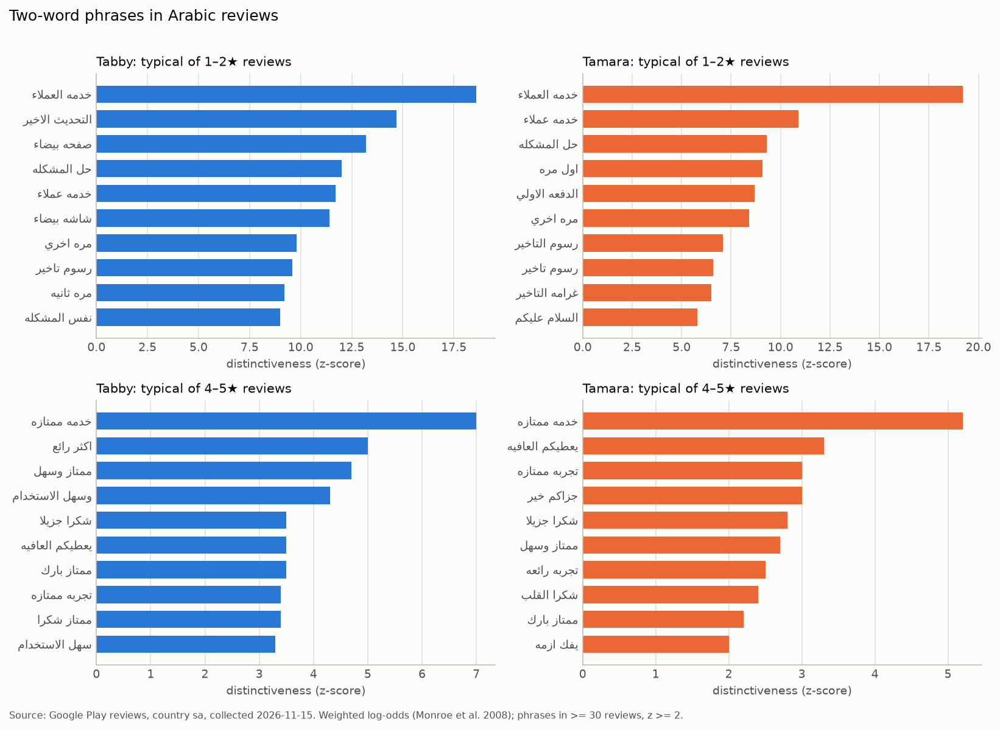

# BNPL in the Gulf: What Tabby and Tamara Users Are Saying

An analysis of about 184,000 public app-store reviews of **Tabby** and **Tamara**, two Buy Now, Pay Later (BNPL) apps, using Arabic and English NLP. Google Play does not filter reviews by country, so the reviews come from users across the Gulf: Arabic reviews appear to come mostly from Saudi Arabia and English reviews mostly from the UAE.

> **Status:** data collection, cleaning and exploratory analysis are complete. Sentiment models are built and are being evaluated on a hand-labeled test set. Topic modeling, the events analysis, an API and a web dashboard are planned (see [Roadmap](#roadmap)).

## Key findings

From 183,341 Google Play reviews (Arabic and English, October 2020 to November 2026):

- **Who is reviewing.** Of the 0.8% of reviews that name a country, city or currency, Arabic ones point to Saudi Arabia 84% of the time and English ones to the UAE 65% of the time. Tabby's reviews are about half English, Tamara's 60% Arabic.
- **Ratings are very positive.** 84% of reviews are 5 stars. Positive reviews are short (median 2 words), while 1-star reviews have a median of 12–13 words, so most of the detail about problems is in the negative reviews.
- **Tamara's review mix changed in February 2026.** Positive reviews fell by about 90% (from about 2,200 to 190 a month), negative reviews by about 37% (from 114 to 72). The average rating dropped from 4.7 to 3.9 mainly because fewer satisfied users reviewed, not because complaints rose. The change lines up with app version 6.0, which suggests the app stopped asking satisfied users for a rating (not confirmed).
- **Tabby's negative reviews spiked in July–August 2026**, reaching 370 and 561 a month against 137–239 in the other months from October 2025 to October 2026. 85% of the Tabby reviews that mention a blank white screen fall in these two months.
- **Both companies reply to about 90% of 1–2 star reviews.** The difference in overall reply rate (Tabby 56%, Tamara 11%) comes from Tabby also replying to positive reviews, which it has done since 2024. In 2025–26, Tamara answered 1–2 star reviews in a median of under an hour and Tabby in about 20 hours; in 2022–23 it was the reverse (Tabby 2–5 hours, Tamara 36–39 hours).
- **Customer service is the most common complaint phrase**, appearing in about 8% of negative reviews for both apps. Phrases typical of negative reviews also point to a blank white screen after app updates (Tabby, 2% of negative reviews) and to late fees and the first payment (Tamara, 1–2% each).




More charts and tables are in [`notebooks/02_eda.ipynb`](notebooks/02_eda.ipynb).

## Data

| Source | Coverage | Use |
|---|---|---|
| Google Play reviews (`google-play-scraper`): `app.tabby.client`, `co.tamara.user` | Full available history for Arabic and English queries, all countries; 183,341 reviews after cleaning | Main dataset |
| Apple App Store public RSS: `1528022364`, `1533512531` | Most recent 500 reviews per app, Saudi storefront | Saudi-only comparison sample |
| Google Trends, manual export | Monthly search interest for "تابي" and "تمارا" in Saudi Arabia from December 2018, plus each term's share of interest by region | Saudi-market context for the events analysis |
| SAMA payments statistics via [KAPSARC](https://data.kapsarc.org) (`pos-transactions`) | Monthly POS and mada e-commerce sales and transactions in Saudi Arabia from January 2019 | Saudi-market context for the events analysis |
| Events timeline (`data/external/events.csv`) | Planned: regulation, funding, product and seasonal events, each with a source URL (not filled yet) | Events analysis |

**Fields kept:** review ID, app, source, query language, text, star rating, review date, thumbs-up count, app version, whether the developer replied, and the reply date. Times are stored in UTC. Reviewer names, profile images and user IDs are never stored.

**Notes on the data:**
- Google Play returns the same reviews whatever store country is requested, so the reviews come from every country where the apps are used. Only 0.8% of reviews name a country, city, currency or national service. Among those, Arabic reviews point to Saudi Arabia (84%) more than to the UAE (13%), and English reviews to the UAE (65%) more than to Saudi Arabia (34%). The App Store sample comes from the Saudi storefront and is more Arabic than Google Play over the same dates (Tabby 67% vs. 41%, Tamara 78% vs. 60%). The events analysis will therefore use Arabic reviews as the closest stand-in for Saudi users.
- Package IDs were checked against the live store listings. Tabby's `app.tabby.cashier` is a separate merchant app and is not used.
- The Google Trends values are a relative index (0–100) on a common scale for both terms, not search volumes. The region export gives each term's share of the two terms' combined interest within a region (each row sums to 100), not the level of interest. The English terms "Tabby" and "Tamara" were excluded because they had much lower search interest and are ambiguous. Export settings are recorded in `config.yaml`.
- The SAMA e-commerce series covers mada debit cards only and excludes Visa, Mastercard and credit-card spending.


## Method

**Collection.** Reviews are collected incrementally, newest first. Each run reads back to the newest review of the last complete run, with a seven-day overlap. Reviews read again are stored again and the latest copy is used, so edits and new developer replies are picked up. The resume point only moves forward after a run finishes without errors or a test cap, so a failed run is repeated rather than leaving a gap. Requests are rate-limited and retried, and raw files are stored as Parquet.

**Cleaning.** The pipeline ([`src/clean/pipeline.py`](src/clean/pipeline.py)) removed 2 double submissions, 73 reviews written only in other scripts (mostly Bengali and Malayalam) and 103 reviews with no usable content (punctuation, digits or a single letter). Identical text from different reviewers (for example "جيد" or "👍") is kept, since each is a separate opinion. Each step is recorded in [`reports/cleaning_log.csv`](reports/cleaning_log.csv).

**Arabic normalization.** A normalized copy of each review is stored next to the original text. It applies Unicode NFKC, unifies alef forms (أ إ آ → ا), taa marbuta (ة → ه) and alef maqsura (ى → ي), removes diacritics and tatweel, converts Arabic-Indic digits, and caps runs of a repeated letter or symbol at two (حلووووو → حلوو). Digits are not capped, so numbers keep their value. Emoji are extracted into a separate column for use as features.

**Language detection.** Language is detected from the text rather than from the store's query language, because each query bucket contains about 2,000 reviews in the other language. Reviews are tagged as Arabic (50%), English (47%), emoji only (2.6%) or mixed (0.1%). No Arabizi (Arabic written in Latin letters) was found. Emoji-only reviews are included in the analysis but excluded from text-model training.

**Gold test set.** 400 Google Play reviews are labeled by hand for sentiment and main topic, with the star rating hidden. The sample is stratified by app, language and star group (40% 1–2 star, 25% 3 star, 35% 4–5 star per app and language), so negative and neutral reviews are over-sampled; each row carries a weight that restores population proportions. Review IDs are replaced by a hash, e-mail addresses, URLs and long numbers are masked, and rows flagged as containing personal information have their text removed. Gold reviews are excluded from model training. Once labeling is complete, 50 random rows will be labeled a second time without seeing the first labels, to measure consistency (Cohen's kappa).

**Sentiment models.** A TF-IDF baseline (character 2–5-grams and word 1–2-grams, logistic regression) is trained on star labels (1–2 stars negative, 3 neutral, 4–5 positive). Its class weighting was chosen on a held-out dev split of star-labeled reviews: square-root balanced weights reached a dev macro-F1 of 0.60, against 0.57 without weights and 0.54 with fully balanced weights, which predicted neutral for 20% of dev reviews when only 2% are neutral. Two pretrained models are used without further training: CAMeLBERT-DA sentiment (Arabic only) and a multilingual XLM-RoBERTa sentiment model (Arabic and English), each pinned to a fixed revision. Results will be reported on the gold set: macro-F1 with stratified bootstrap intervals, population-weighted metrics, a negative-vs-positive view, and paired bootstrap intervals for the difference between models.

**Distinctive phrases.** Words and two-word phrases are ranked with the weighted log-odds ratio with an informative Dirichlet prior (Monroe, Colaresi & Quinn, 2008), comparing 1–2 star with 4–5 star reviews, separately for each app and language. Counts are the number of reviews that contain a phrase, and the prior is weak, so the ranking is close to a smoothed log-odds ratio. It shows which phrases separate negative from positive reviews, not which are most frequent; how often complaint phrases occur is counted separately.

## Limitations

- App reviews are not a random sample of users. Unhappy users are more likely to write long reviews, and in-app rating prompts affect who reviews; the Tamara change in February 2026 suggests such an effect.
- Google Play reviews cannot be limited to one country, and few reviews say where the reviewer is.
- Star ratings are a noisy measure of sentiment. Final model results will be reported on a hand-labeled test set, labeled by one person.
- Review dates are the latest edit of a review, and reply dates the latest edit of a reply, so a response time can be longer or shorter than the time to the first reply. Replies dated before the review's latest edit (1.3% for Tabby, 2.7% for Tamara) are excluded.
- "تمارا" is also a given name, so part of Tamara's search interest is unrelated to the app.
- There is no access to company transaction data. Results describe what users write, not how the companies perform.

## Project structure

```
├── config.yaml              # app IDs, paths and parameters
├── src/
│   ├── collect/             # Google Play, App Store RSS, KAPSARC, Google Trends
│   ├── clean/               # normalization, language detection, cleaning pipeline
│   ├── label/               # gold-set sampling and labeling widget
│   ├── models/              # sentiment baseline, pretrained transformers, evaluation
│   └── analysis/            # EDA tables and chart helpers
├── notebooks/               # collection checks, EDA and gold-set labeling
├── reports/                 # cleaning log, model results and figures
├── data/                    # raw and processed data (not committed), external sources
└── tests/
```

## How to run

```bash
python -m venv .venv
# Windows: .venv\Scripts\activate    macOS/Linux: source .venv/bin/activate
pip install -r requirements.txt

python -m src.collect.play_store                   # Google Play reviews, both apps (incremental)
python -m src.collect.play_store --max-reviews 50  # quick test
python -m src.collect.play_store --full            # read the full history again
python -m src.collect.app_store                    # App Store RSS reviews
python -m src.collect.sama_kapsarc                 # SAMA payments statistics
python -m src.collect.google_trends                # clean Google Trends exports
python -m src.clean.pipeline                       # clean and normalize reviews
jupyter notebook notebooks/02_eda.ipynb            # exploratory analysis
python -m src.label.gold --sample                  # draw the gold-set sample
jupyter notebook notebooks/gold_labeling.ipynb     # label it
python -m src.label.gold --relabel                 # draw rows for a second, blind labeling
python -m src.models.baseline --compare-class-weights  # choose class weighting on the dev split
python -m src.models.baseline                      # train the TF-IDF baseline
python -m src.models.transformer                   # score with pretrained transformers
python -m src.models.evaluate                      # metrics on dev and gold sets

pytest
```

All settings (app IDs, languages, rate limits, paths, cleaning thresholds, model revisions) are in `config.yaml`. On Windows, use a short project path or enable long paths: PyTorch's installation contains deeply nested files that can exceed the 260-character path limit.

## Roadmap

- [x] Data collection
- [x] Cleaning, normalization and exploratory analysis
- [ ] Sentiment models: TF-IDF baseline vs. pretrained transformers, evaluated on a hand-labeled test set (models built, labeling in progress)
- [ ] Topic modeling of complaints and praise
- [ ] Sentiment trends compared with regulation, product and seasonal events
- [ ] Prediction API (FastAPI)
- [ ] Web dashboard (Flutter)

## Data and ethics

Only public review text and ratings are used. No names or personal data are stored or published, and raw review data is not committed or redistributed (`data/raw/` and `data/processed/` are gitignored). The repository contains only code, aggregate tables, figures and, later, the hand-labeled test set. In that set, review IDs are replaced by hashes and e-mail addresses, URLs and long numbers are masked, but the text itself is public review text. Results describe user opinions, not company performance.
